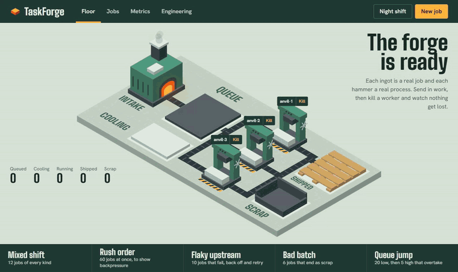
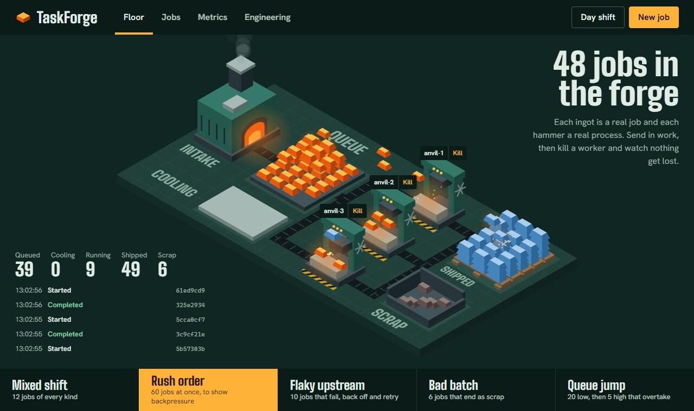
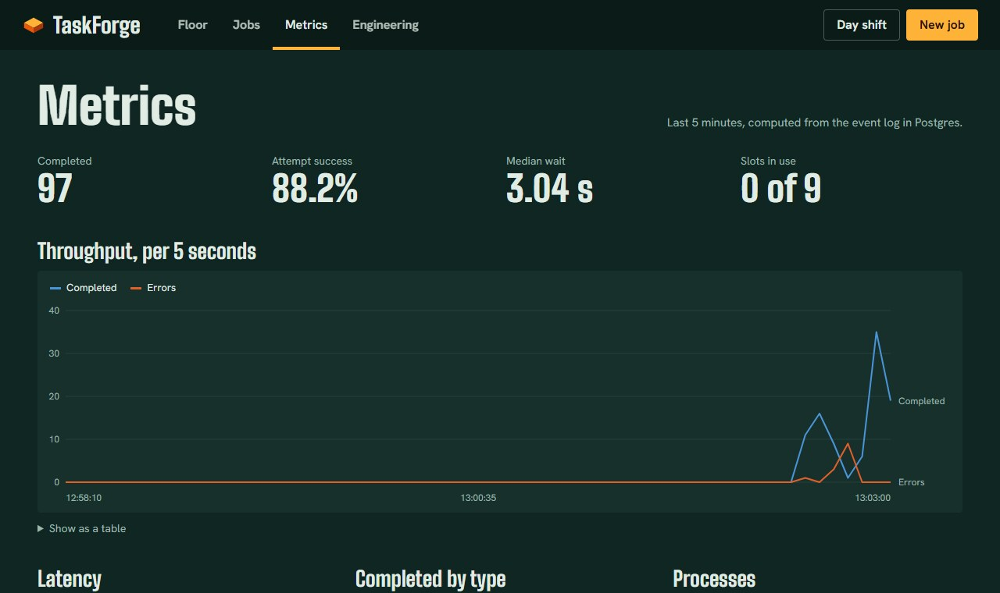

# TaskForge

A crash-safe background job system built on PostgreSQL and Redis, with a live factory floor where every
ingot is a real job and every hammer is a real worker process.



*A worker is killed mid-job. Its leases expire, the jobs return to the queue and the others finish them.*

## Try it

With Docker:

```sh
docker compose up --build
```

Open <http://localhost:4000>, press **Rush order**, then **Kill** one of the workers.

To host it free as a public demo, see [deploy/render](deploy/render/README.md).

## 📝 Description

TaskForge is a background job processing system that lets a backend server handle long-running tasks
asynchronously without blocking incoming client requests.

In a typical web application, a request that triggers a heavy task, such as sending emails, generating
reports or processing files, makes the client wait until that task finishes. TaskForge saves the task,
answers straight away, and lets separate worker processes do the work.

Doing that is easy. Doing it without losing work when processes crash, networks drop and databases
restart is the interesting part, and it is what this project is about.

## 🚀 What it guarantees

| When this happens | TaskForge does this | Where |
| --- | --- | --- |
| A worker is killed mid-job | The lease expires and another worker takes over | `recoverExpiredLeases` |
| A frozen worker wakes up late | Its write is rejected by a fencing token | `completeJob`, `failJob` |
| Redis is down | Jobs are still accepted, and dispatched when it returns | `dispatch`, sweeper |
| Redis loses its data | The queue is rebuilt from Postgres | `takeDispatchable` |
| Postgres restarts | API, workers and live stream reconnect | `db/postgres.ts`, `eventStream.ts` |
| Two workers get the same job | One conditional update wins | `claimJob` |
| A task keeps failing | Exponential backoff with jitter, then a failed state you can requeue | `retryDelay` |
| A client retries a request | `Idempotency-Key` returns the original job | `insertJobs` |
| Urgent work floods the queue | Priority ages, so low priority cannot starve | `queueScore` |
| A worker is stopped for a deploy | It drains, then hands work back without using an attempt | `WorkerRuntime.stop` |

Each row has an automated test, except the live stream's reconnect after a Postgres restart.

## ⚙️ How it works

1. **Submit.** The API validates the job and commits it to Postgres with an event, in one statement.
   Only then does it add the id to a Redis sorted set. If that second step fails, the job is still safe.
2. **Claim.** A worker with a free slot pops an id and runs a conditional `UPDATE`. The message is only a
   hint, and Postgres decides who owns the job. The winner receives a lease and a random fencing token.
3. **Run.** The handler gets an `AbortSignal` that fires on timeout, cancellation, lost lease or shutdown.
   Heartbeats renew the lease for as long as the job runs.
4. **Finish.** Completion, retry and failure all require the fencing token.
5. **Repair.** Every worker runs a sweeper that reclaims expired leases and re-dispatches due jobs.
   `FOR UPDATE SKIP LOCKED` means no leader election is needed.
6. **Watch.** A trigger sends `NOTIFY` on commit, the API relays it over Server-Sent Events, and periodic
   snapshots correct anything the browser missed.

## 🖥 Interface

| Night shift | Metrics |
| --- | --- |
|  |  |

- **Floor:** a hand-written isometric canvas renderer with no 3D or animation library. Click any ingot.
- **Jobs:** filters, search by id, cursor pagination, full attempt history, cancel and requeue.
- **Metrics:** throughput, p50 and p95 latency, worker load. The chart is plain SVG.
- **Engineering:** each failure mode, next to the code that handles it.

It works on phones, with a keyboard, and with reduced motion.

## 🛠 Tech stack

- **Server:** Node.js 22 (running TypeScript natively), Express 5, Zod, `pg`, `ioredis`
- **Client:** React 19, TypeScript, Vite, hand-written CSS
- **Data:** PostgreSQL 17, Redis 7
- **Quality:** `node:test`, strict TypeScript, GitHub Actions, Docker

## ▶️ Development

Requires Node 22.18 or newer, and Docker for the databases.

```sh
npm run setup
npm run infra
npm run dev
```

Open <http://127.0.0.1:5188>. This starts the API, three workers and Vite. Killed workers are restarted.

```sh
npm test
npm run test:integration
npm run typecheck
```

`npm test` needs nothing running. `npm run test:integration` needs `npm run infra`. Both that and
`npm run dev` ignore `PG*` and `REDIS_*` variables in your shell, so they can't land on your own databases.
Override with `TEST_PG*` for tests, or `server/.env` for the dev runner.

To run the pieces yourself against your own Postgres and Redis, copy `server/.env.example` to
`server/.env`, then:

```sh
cd server
npm ci
npm run dev
npm run worker
```

Run the last two in separate terminals. The schema is created on first start.

## 🔌 API

| Method | Path | |
| --- | --- | --- |
| `POST` | `/api/jobs` | Create a job. Accepts `Idempotency-Key` |
| `GET` | `/api/jobs` | List, with `status`, `type`, `search`, `before`, `limit` |
| `GET` | `/api/jobs/:id` | A job and its history |
| `POST` | `/api/jobs/:id/cancel` | Cancel, even while it runs |
| `POST` | `/api/jobs/:id/retry` | Requeue a failed or cancelled job |
| `GET` | `/api/snapshot` | Counts, throughput, latency, workers |
| `GET` | `/api/events` | Live Server-Sent Events |
| `GET` | `/api/health` | `ok`, `degraded` or `down` |
| `POST` | `/jobs` | v1 endpoint, same response as before |
| `GET` | `/jobs/:id` | v1 endpoint |

```sh
curl -X POST http://localhost:4000/api/jobs \
  -H "Content-Type: application/json" \
  -H "Idempotency-Key: welcome-42" \
  -d '{"type":"email","payload":{"to":"ada@example.com"},"priority":"high"}'
```

### Adding a job type

Write a handler, then add it to `server/jobs/registry.ts`. Validation and the UI form follow from it.

```ts
export const resizeJob = defineJob({
  title: "Resize image",
  description: "Creates a thumbnail.",
  timeoutMs: 10_000,
  schema: z.object({ width: z.number().int().max(4000) }),
  fields: [{ name: "width", label: "Width", kind: "number", default: 320 }],
  async run({ width }, { id, signal }) {
    // Pass `signal` to anything slow, and use `id` as the idempotency key for side effects.
  },
});
```

## 📁 Project layout

```
server/
  api/          HTTP app, security checks, error handling
  controllers/  request and response mapping
  routes/       URL tables
  services/     job state machine, queue, stats, live events
  worker/       consume, heartbeat and sweep loops
  jobs/         one file per job type
  db/           pool and SQL migrations
  test/         unit and integration tests
client/src/
  floor/        isometric kit, scene model, renderer
  pages/        floor, jobs, metrics, engineering
  components/   dialogs, chart, forms
  lib/          API client, live data, routing
```

## ⚖️ Limits and trade-offs

- **At-least-once delivery.** A worker can die between a side effect and recording it, so handlers must be
  idempotent. No queue can promise exactly-once side effects.
- **Email is simulated.** The report and hash jobs do real work.
- **No authentication.** Ports bind to loopback, and Host and Origin are checked. Use an authenticating
  proxy before exposing it, and turn `DEMO_MODE` off. The exception is a throwaway public demo with
  `PUBLIC_DEMO` on, which adds rate limits and caps and refuses visitor-typed text.
- **Throughput is bounded by Postgres**, which is written on every transition. `NOTIFY` also serialises
  commits. Both are fine at this scale and would be the first things to change at a much larger one.
- **Events are never pruned.** A busy deployment needs a retention job.

## Upgrading from v1

- Stop v1 workers first. The first start migrates an existing `jobs` table in place, so back it up.
- CORS is now off by default. List browser origins in `CORS_ORIGINS`.
- The server binds to `127.0.0.1` unless `HOST` says otherwise.
- Unknown job types and invalid payloads are rejected with 400 where they used to be accepted.

## License

[MIT](LICENSE), Sarvesh Mohite
